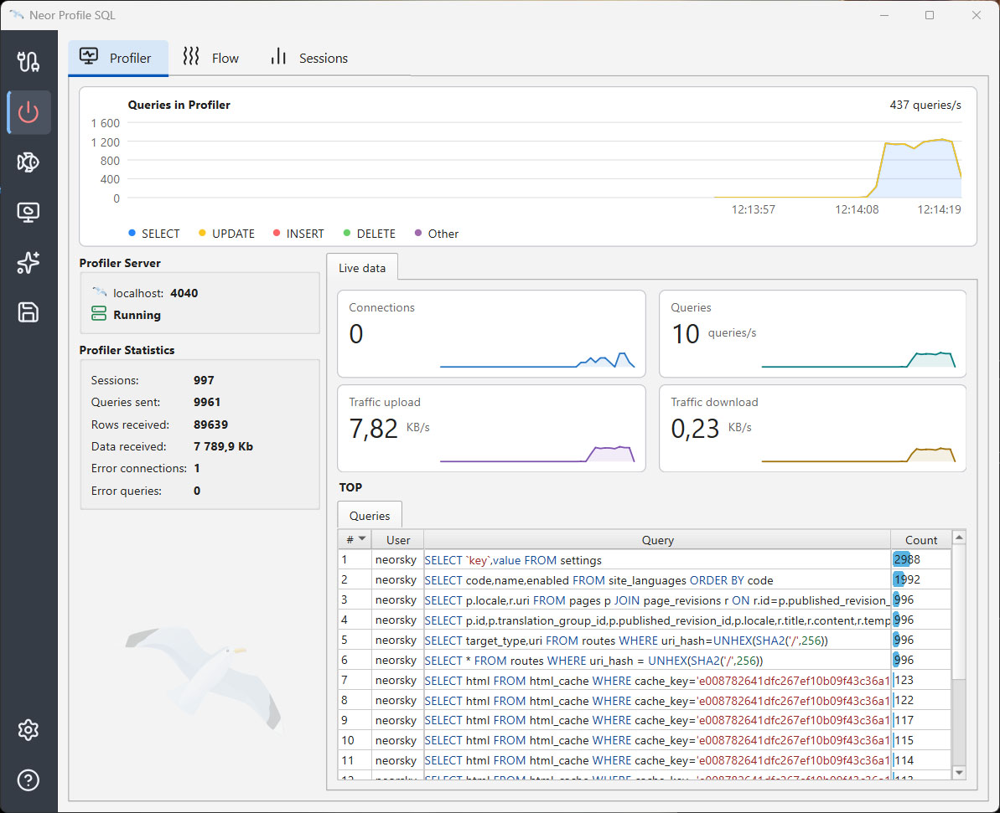

# Neor-Profile-SQL
Cross-platform database optimization application. It works like a proxy for catching sessions and SQL queries to the database MySQL / MariaDB or Postgres.

## Main features
- Database loading
- Show and analyze sessions to the database
- Show all queries
- Find duplicate queries
- Explain SQL queries
- Profile SQL queries
- Index Analyzer
- SQL editor
- Multilanguage
- Cross-platform

## Support databases
- MySQL
- MariaDB
- Postgres
 
## Support OS
- Windows 
- MacOS
- Linux

## Last releases
https://github.com/neor/Neor-Profile-SQL/releases

## Bug/Issue report
https://github.com/neor/Neor-Profile-SQL/issues

## Official site
https://profilesql.com/
